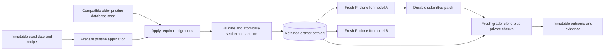

# SWE-bench research for the Elixir benchmark

Research date: **2026-10-13**. This document informs the proposed expansion toward approximately 250 Plausible and 250 Livebook cases. It does not admit cases, change the benchmark, or report performance measurements.

## Decision supported by the evidence

**Prepare and qualify each immutable case once; reuse its pristine application and database artifacts across model campaigns; create independent writable clones for Pi and grading.** Ordinary model runs should not repeat dependency installation, the baseline application build, or historical database initialization when those exact artifacts remain valid and present. Patch compilation, service startup, executing checks, model inference, and writing evidence still occur. “Warm preparation” is a defensible design goal; “instant run” is not an established result.

SWE-bench supports this separation through reusable task environments and independent patch evaluation. Its stronger lesson is that environment reuse alone does not make a trustworthy benchmark: task clarity, acceptance tests, preservation coverage, clean repositories, parser correctness, and immutable release identities all need independent qualification.

The existing cache foundation is compatible with this direction. Before admitting new PRs, finish the release and qualification contract, demonstrate the full lifecycle on the existing twelve cases, and review a small diverse set of candidates without making it an official comparison release. The requested 500 cases should be a curation target, not a quota that weakens admission requirements.

## Scope, evidence, and version pins

This research inspected primary papers, official announcements and annotation instructions, dataset cards, submission requirements, and source code. It did not run SWE-bench, our benchmark cases, Docker builds, performance tests, or bulk dataset downloads. External authors' measurements below describe their studies, not this machine.

| Component | Inspected version | Why it matters |
|---|---|---|
| Current SWE-bench harness | [`02e7a74ffd0b707aab73d203fe87bdc7c76afc8e`](https://github.com/SWE-bench/SWE-bench/tree/02e7a74ffd0b707aab73d203fe87bdc7c76afc8e), September 2026 | Current code differs materially from still-published Docker/cache guidance. |
| Historical harness | [`v3.0.15`, `b524f150d5d76f188c741d75669025f718c89c2e`](https://github.com/SWE-bench/SWE-bench/tree/b524f150d5d76f188c741d75669025f718c89c2e), March 2025 | Concrete source for the familiar base/environment/instance cache hierarchy. |
| Official submissions | [`40f164d5b8f1d249bf95a6df8b74b577fd8e519d`](https://github.com/SWE-bench/experiments/tree/40f164d5b8f1d249bf95a6df8b74b577fd8e519d) | Artifact and reproducibility requirements. |
| Verified dataset | [`78f471bf655a3137b2e8a75af1501690ec009ec3`](https://huggingface.co/datasets/SWE-bench/SWE-bench_Verified/tree/78f471bf655a3137b2e8a75af1501690ec009ec3) | Dataset revisions and schema must be recorded independently of the harness. |
| Scale Pro dataset | [`2d52cb3df914a3fcf80c7f66738b3a88ae37fc50`](https://huggingface.co/datasets/ScaleAI/SWE-bench_Pro/tree/2d52cb3df914a3fcf80c7f66738b3a88ae37fc50), September 2026 | The default is now V2; old Pro results do not automatically describe it. |

Links to moving documentation are supporting context. Where documentation and implementation disagree, the pinned implementation establishes the behavior described here. Papers establish their own historical methodology, not every later harness default.

## What the different benchmarks actually are

| Benchmark | Scope and selection | Implication for this project |
|---|---|---|
| Original SWE-bench | 2,294 issue/PR tasks from 12 Python repositories; repositories at a pre-solution revision plus an issue description. [Original paper, v3](https://arxiv.org/html/2310.06770v3) | A task is a reproducible engineering change with an executable oracle, not merely a downloaded PR. |
| SWE-bench Lite | 300 test tasks and 23 development tasks. Selection removes multi-file patches, more than three hunks, file creation/deletion, and several difficult prompt/test forms. [Official Lite description](https://www.swebench.com/lite.html) | Its simplicity filters would exclude much of our intended feature, refactor, and full-stack scope. |
| SWE-bench Verified | 500 original tasks selected through human screening introduced in 2024. “Verified” describes that process; it is not a permanent correctness guarantee. [OpenAI introduction](https://openai.com/index/introducing-swe-bench-verified/) | Reuse the review discipline, not the assumption that once-reviewed tasks never need correction. |
| SWE-bench Multilingual | 300 tasks, 42 repositories, nine languages; manually configured and checked. Distinct from the separately developed Multi-SWE-bench. [Official description](https://www.swebench.com/multilingual) | Language/runtime adapters and manual environment work are expected. It is not an Elixir-ready importer. |
| SWE-bench Pro, original | Scale's separate benchmark: 1,865 tasks across public, held-out, and commercial sets; the original public set has 731 cases. It adds explicit requirements and interface descriptions. [Original Pro paper, v1](https://arxiv.org/html/2509.16941v1) | Larger, multi-file tasks require especially careful public contracts and hidden tests. |
| SWE-bench Pro V2 | Scale's September 2026 revision: 642 default tasks, original 731 retained as `v1`, separate 51-task `hard` subset. [Pinned V2 card](https://huggingface.co/datasets/ScaleAI/SWE-bench_Pro/blob/2d52cb3df914a3fcf80c7f66738b3a88ae37fc50/README.md) | Freeze dataset version and subset; neither name nor case ID alone establishes comparability. |
| SWE-Bench Pro Verified | A distinct OpenCompass-associated 2026 revision of the 731-case Pro set, described in a recent preprint. [Zheng et al., v3](https://arxiv.org/html/2609.08149v3) | Do not confuse it with OpenAI's 2024 SWE-bench Verified or Scale's Pro V2. |

These sets differ in repositories, task distribution, contracts, environment recipes, and evaluation protocols. A percentage from one is not a difficulty-adjusted equivalent of another. Our two-project Elixir/Phoenix benchmark should be presented as its own benchmark with explicit coverage, not as a directly comparable SWE-bench score.

## Construction: from a merged PR to an admissible task

### Established practice

The original pipeline collected merged PRs linked to issues, required test changes, and validated behavior before and after the reference solution. Nonempty fail-to-pass evidence distinguishes an actual task from a patch whose tests already pass. Installation/runtime failures were filtered during construction. The reference implementation is a source of validation evidence, not a byte-for-byte solution matcher. The original paper also studied retrieval-based systems; those results are not the protocol of every current agent. [Original paper](https://arxiv.org/html/2310.06770v3)

The collection tooling itself does not turn every extracted PR into a qualified evaluation case. Its documented extraction stages produce raw PR records and candidates with test changes; executable validation remains a separate stage. The upstream tools encode repository and ecosystem assumptions rather than providing universal language-independent admission. [Pinned collection README](https://github.com/SWE-bench/SWE-bench/blob/02e7a74ffd0b707aab73d203fe87bdc7c76afc8e/swebench/collect/README.md)

The inspected Verified schema includes repository and base commit, environment setup commit, issue text, hints, source patch, test patch, F2P/P2P lists, and execution metadata such as image, evaluation script, parser, and evaluation type. Current schema metadata uses list-valued test fields even though historical documentation describes JSON-encoded strings. A consumer must validate its pinned schema rather than guess from an older example. [Pinned Verified card](https://huggingface.co/datasets/SWE-bench/SWE-bench_Verified/blob/78f471bf655a3137b2e8a75af1501690ec009ec3/README.md), [current TestSpec types](https://github.com/SWE-bench/SWE-bench/blob/02e7a74ffd0b707aab73d203fe87bdc7c76afc8e/swebench/types.py)

### Recommended admission pipeline for Plausible and Livebook

1. **Discover candidates.** Save immutable issue/PR text, timestamps, original base and fixing commits, upstream license, source archive identity, and the reasons a candidate appears relevant. Discovery does not publish a benchmark case.
2. **Classify the intended change.** Record project, task kind, subsystem, languages, runtime family, external-service needs, and whether it changes public APIs, data, UI behavior, or structure. Detect related PRs and duplicate task families before sampling.
3. **Write the solver contract.** State observable behavior and required interfaces using only information Pi receives. Include exact names when callers or tests require them. Preserve provenance for editorial clarifications; do not retrospectively infer requirements from a particular model's failure.
4. **Separate artifacts.** Produce an agent-visible source snapshot and prompt; evaluator-only acceptance/preservation checks; a reference patch; and an environment recipe. Do not copy the full curator record into the agent workspace.
5. **Prepare the baseline.** Resolve pinned tools and dependencies, build pristine source, initialize services, validate the state, and atomically publish immutable application/database artifacts. Record all identities and preparation failures.
6. **Qualify the contract.** Establish that unchanged code fails the declared acceptance criterion, reference code passes it, required preservation checks pass, execution really completes, and the checks reject relevant deliberately incomplete solutions. Diagnose failures by phase, not by a single exit code.
7. **Independently review.** A reviewer first reads only the solver-visible contract, then compares requirements against each grading assertion. For difficult features/refactors, a blind implementation by another engineer is stronger evidence than another reading of the reference patch.
8. **Admit to an immutable release.** Save the exact case list, order, artifacts, contract, evaluator version, review decisions, and rejection reasons. Corrections create a new case/release version; never silently alter a running comparison's denominator.

A fixed release should cover the engineering work we want to measure. Do not select the main inventory according to which target models happen to fail it. A labeled diagnostic subset can answer narrower questions, but it must not quietly replace the main release.

## Grading, tests, and the meaning of “resolved”

F2P checks fail on unchanged code and pass after a correct change. P2P checks pass before and after, protecting existing behavior. Standard SWE-bench resolution requires all required F2P and P2P outcomes, rather than textual agreement with the reference patch. This does not guarantee that the chosen checks cover every requirement or regression. [Original evaluation methodology](https://arxiv.org/html/2310.06770v3)

The current grader contains compatibility rules that matter when interpreting outcomes. In ordinary pass/fail mode, missing required results fail; expected-failure statuses can count as passing; skipped P2P checks can count as maintained whereas skipped F2P checks fail. Its failure-only adapter instead treats absence of an explicit failure as success after validating execution. Empty F2P/P2P sets receive a vacuous success ratio, making admission checks essential. It checks for evidence that tests actually ran and detects contradictory exit status. Truncated parameterized test identifiers require fallback matching, illustrating that test identity and log parsing are part of the oracle. These are implementation-specific semantics, not defaults to adopt blindly. [Pinned grading source](https://github.com/SWE-bench/SWE-bench/blob/02e7a74ffd0b707aab73d203fe87bdc7c76afc8e/swebench/harness/grading.py)

**Our benchmark intentionally adds a requirement:** Pi must provide regression-test evidence as well as the implementation. Standard SWE-bench's percentage resolved generally grades supplied checks without requiring model-authored regression coverage. Preserve our accepted requirement in the manifest and report it as a separate dimension; do not claim SWE-bench-equivalent scoring.

| Our task kind | Acceptance evidence | Preservation evidence | Important admission trap |
|---|---|---|---|
| Bug fix | Named behavior fails before, passes after | Relevant prior behavior remains valid | A setup exception is not proof that the reported bug was reproduced. |
| Feature | Declared new capability or API is absent before, present after | Existing API/UI/data behavior remains valid | A missing new API can legitimately prevent a new test from compiling; use an explicit capability adapter/precheck rather than relabeling every compiler failure as acceptance evidence. |
| Objective refactor | A public structural/interface requirement fails before and passes after | Behavior remains equivalent where promised | Behavior-preservation tests alone may pass unchanged code. Do not invent a behavioral defect merely to force traditional F2P. |
| Full-stack change | Declared browser/API/data behavior, with pinned assets and deterministic local dependencies | Relevant server, client, and data contracts | Browser launch/network failures, screenshots, and assertion failures need distinct adapters and verdicts. |

For all kinds, require an unchanged-code negative control and a reference positive control. Add targeted incomplete implementations where they test a meaningful loophole. A partial solution that satisfies one assertion must not pass an entire task accidentally. Maintain a requirements-to-checks traceability matrix; record both unsupported assertions and requirements lacking coverage. Structural checks should test an explicit objective property, not preferred formatting or exact reference-source layout.

The current local grader already validates complete suite markers, unique test identities, known exclusions, and test-vs-setup failure phases. Its command adapter still explicitly requires `mix test`. The broader feature/refactor/full-stack contract is documented work, not a completed general adapter system. [Local grader](/home/bat/projects/elixir-agent-benchmark/lib/eab/grader.ex:4), [task-contract ADR](/home/bat/projects/elixir-agent-benchmark/docs/adr/0007-grade-features-and-refactors-by-explicit-contracts.md:3)

## Human review and why “verified” is insufficient by itself

### The 2024 Verified procedure

OpenAI sampled 1,699 original tasks for review, used 93 Python developers with onboarding, and obtained three independent annotations per task. The rubric covered issue specificity and whether tests reject valid solutions, plus difficulty and other problems. Selection conservatively used the highest severity across reviewers for key exclusions; difficulty used majority/median aggregation. This is a practical way to surface disagreement, not proof that the strictest reviewer is always correct. The resulting benchmark retained 500 tasks. [Verified announcement](https://openai.com/index/introducing-swe-bench-verified/)

The annotation instructions explicitly warn against tests depending on unstated function names, variable names, or exact error text. Reviewers assess the description actually given to the solver rather than relying on linked discussion, and provide reasons and confidence. For our task authoring, the useful unit is a defensible requirement-to-assertion relationship, with recorded disagreement and adjudication. [Original annotation instructions, pages 1–5](https://cdn.openai.com/introducing-swe-bench-verified/swe-b-annotation-instructions.pdf)

### Subsequent findings, in chronological order

**February 2026 — Verified criticism.** OpenAI examined 138 difficult Verified tasks, a selected 27.6% subset, and reported material task/test flaws in 59.4% of that subset. It also presented contamination examples in tested frontier models and recommended Pro at the time. This was not a random prevalence estimate for all 500 tasks, and the recommendation was subsequently withdrawn. [OpenAI, February 23](https://openai.com/index/why-we-no-longer-evaluate-swe-bench-verified/)

**July 2026 — Pro criticism and withdrawal.** OpenAI's later audit of the original 731 public Pro tasks first flagged 286. Agent-supervised review identified issues in 200/731; human review identified 249/731. Its categories were overly strict tests, underspecified requirements, misleading prompts, and insufficient coverage. Flagged tasks received five engineer reviews; category overlap between approaches was 74%. OpenAI withdrew its recommendation for Pro. These numbers describe that version and audit protocol, not every later dataset carrying “Pro” in its name. [OpenAI, July 8](https://openai.com/index/separating-signal-from-noise-coding-evaluations/)

**September 2026 — Scale Pro V2.** Scale reports dropping 89 original tasks, rewriting 529 prompts so graded assertions map to stated requirements, and having a second engineer implement revised instructions blind. It also revised tests/parsers, sanitized and rebuilt images, and required reference success plus empty-patch failure. Its recommended protocol limits agent network access to the model endpoint and regrades the submitted diff in a pristine environment. These are release authors' reported controls, not an independent certification. The 51-task hard subset is selected using failures across five model families; that makes it useful for diagnostics, not a neutral replacement for the main distribution. [Pinned V2 card](https://huggingface.co/datasets/ScaleAI/SWE-bench_Pro/blob/2d52cb3df914a3fcf80c7f66738b3a88ae37fc50/README.md)

**October 2026 — distinct Pro Verified proposal.** Zheng and colleagues describe a 731-case revision with 102 minimally refined tasks, fresh single-commit repositories including nested Git cleanup, removal of grading artifacts/hooks, metadata filtering, anonymized IDs, and code-host blocking. The authors acknowledge residual artifact risks, incomplete blocklists, and undiscovered task problems. This recent preprint contributes concrete sanitation ideas; it does not establish that all flaws or contamination are gone. [Paper, especially §5.2](https://arxiv.org/html/2609.08149v3), [authors' implementation](https://github.com/open-compass/AgentCompass)

**Independent correctness evidence.** Wang, Pradel, and Liu studied passing patches from three systems. Broader developer tests rejected 7.8%; their differential-testing approach found behavior divergence in 29.6%. In a manual sample of 77 suspicious patches, 22 were judged certainly incorrect, four certainly correct, and 51 uncertain. Divergence from the reference is therefore not synonymous with an incorrect solution. Sampling, generated-test quality, and human judgment limit generalization. Our practical response should be broader relevant preservation coverage and review of alternative correct solutions, not exact-reference matching. [ICSE 2026 paper, including §5.3](https://software-lab.org/publications/icse2026_SWE-bench-correctness.pdf)

### Consequences for our release process

The original Pro construction process included expert environment setup and repeated test runs to screen for flaky behavior. Repetition is useful evidence of stability under a particular environment, but it cannot prove that a test is correctly specified or covers all valid implementations. [Original Pro construction methodology](https://arxiv.org/html/2509.16941v1)

Keep reviewer reasoning and disagreements, not only a Boolean “qualified.” Review a sample of both passing and failing agent results when auditing a release; failure-only audits cannot find all false positives. Quarantine a questionable case pending review, preserve existing results, and issue corrected release identities rather than retroactively treating an old score as unchanged. Repeated deterministic controls can detect flakiness but cannot establish broad correctness alone.

Public historical PRs remain potentially known to pretrained models even with perfect sandbox cleanup. Record this limitation. Removing answer artifacts from the workspace prevents avoidable runtime leakage; it does not erase prior model exposure. A future private or genuinely held-out set would answer a different question and needs separate collection and access policies.

## How preparation is reused: historical and current harness behavior

### The classic hierarchy was concrete, but version-specific

Historical v3.0.15 defined three image identities. The base image grouped runtime/language and architecture; the environment image key hashed its environment setup script and Docker specifications; the instance image identified the task. Environment builds could be shared across instances with equivalent setup. These are useful architectural layers, but a task-named image tag is not a proof that all relevant inputs are content-addressed. [Historical TestSpec](https://github.com/SWE-bench/SWE-bench/blob/b524f150d5d76f188c741d75669025f718c89c2e/swebench/harness/test_spec/test_spec.py)

That version skipped existing base/environment images, grouped environment builds, and built or pulled instance images as required. Builds could use a worker pool. [Historical build code](https://github.com/SWE-bench/SWE-bench/blob/b524f150d5d76f188c741d75669025f718c89c2e/swebench/harness/docker_build.py)

Its cache levels were `none`, `base`, `env`, and `instance`. With the historical default `env`, newly created instance images could be removed while existing images were retained unless `clean` requested removal; `instance` retained the whole hierarchy. Cache retention policy therefore determined whether a subsequent model reused the exact ready case or rebuilt its final image. [Historical cleanup semantics](https://github.com/SWE-bench/SWE-bench/blob/b524f150d5d76f188c741d75669025f718c89c2e/swebench/harness/docker_utils.py), [historical defaults](https://github.com/SWE-bench/SWE-bench/blob/b524f150d5d76f188c741d75669025f718c89c2e/swebench/harness/run_evaluation.py)

Multilingual deliberately omitted intermediate environment images because its wider repository distribution offered less dependency sharing, retaining base and instance images. Its authors manually chose commands and validated pre/post behavior. This is evidence that the right cache hierarchy depends on the corpus, not that every benchmark should always use three layers. [Multilingual environment design](https://www.swebench.com/multilingual)

### Current code should not be described using old flags

The currently published evaluation/Docker guides still describe the older cache hierarchy and controls. Treat those instructions as potentially stale for the inspected commit. [Evaluation guide](https://www.swebench.com/SWE-bench/guides/evaluation/), [Docker guide](https://www.swebench.com/SWE-bench/guides/docker_setup/)

The current CLI defaults to four workers and a 1,800-second evaluation timeout, and no longer exposes the former `cache_level`, `clean`, or `force_rebuild` evaluation arguments. These are evaluator defaults, not model turn limits. [Pinned CLI](https://github.com/SWE-bench/SWE-bench/blob/02e7a74ffd0b707aab73d203fe87bdc7c76afc8e/swebench/cli/evaluate.py)

Tasks now carry an image and evaluation script. An image specification uses architecture, instance ID, namespace and tag; the default tag is `latest`. Resolve and record immutable image digests when reproducibility matters. [Current types](https://github.com/SWE-bench/SWE-bench/blob/02e7a74ffd0b707aab73d203fe87bdc7c76afc8e/swebench/types.py), [image identity](https://github.com/SWE-bench/SWE-bench/blob/02e7a74ffd0b707aab73d203fe87bdc7c76afc8e/swebench/image_builder/image_spec.py)

The image builder skips locally present images unless rebuilding is requested, and uses parallel Buildx jobs. Forced rebuilding removes image tags but still permits Docker layer-cache reuse; it is not automatically a no-cache build. [Current image builder](https://github.com/SWE-bench/SWE-bench/blob/02e7a74ffd0b707aab73d203fe87bdc7c76afc8e/swebench/image_builder/docker_build.py)

At evaluation, the harness obtains the local image or pulls it, creates a container, applies the prediction, copies the evaluation script, executes it, saves outputs, grades, and removes the container. Optional local preparation can fall back to published images when an expected build is unavailable. Containers receive `SYS_ADMIN` for browser sandboxes; these defaults are not our sandbox policy. Existing report files are reused under run/model/instance directories without validating a newly supplied patch hash. Run metadata records dataset, split, task-repository identifier, and creation time, not automatically all immutable digests. These are reasons to adopt stronger identities and explicit fallback/resume policy locally. [Current execution source](https://github.com/SWE-bench/SWE-bench/blob/02e7a74ffd0b707aab73d203fe87bdc7c76afc8e/swebench/harness/run_evaluation.py)

### What remains for every model or attempt

| Work | Reuse target | Work that remains |
|---|---|---|
| OS, language tools, dependency archives | Pinned shared layers/artifacts | Initial preparation; rebuild only on changed inputs or missing artifacts. |
| Exact PR base source and application build | Sealed project image | Compilation invalidated by Pi's actual edits; changed dependency declarations may require additional permitted work. |
| Initialized PostgreSQL/ClickHouse state | Sealed exact case baseline | Start isolated services and create independent writable state; validate readiness. |
| Pi runtime | Separately identified agent image | Start Pi with current prompt, model, and settings; inference and tool actions. |
| Qualification | Identity-bound evidence | Requalify when the contract/evaluator/relevant environment changes. |
| Grading | Reusable pristine artifacts | Fresh grader clone, apply the submitted diff and hidden checks, compile affected code, run checks, parse and store evidence. |
| Completed model outcome | Exact run/attempt checkpoint only | Never reuse model A's outcome as model B's result. |

Docker layer reuse and retaining a completed application image solve different problems. Layer reuse helps construct a missing image; retaining the exact completed artifact avoids entering that build path at all. A database snapshot adds state that a conventional source/dependency image may not contain. Deleting an attempt container should not delete the retained baseline images or cache records. Conversely, an external Docker prune can destroy physical artifacts; saved metadata alone cannot make them usable.

No inspected source establishes a latency guarantee for our particular Elixir applications, databases, storage driver, and workload. Correctness tests can demonstrate that installation/migration commands are skipped on a valid hit and clones remain independent. Performance qualification, if later requested, requires an authorized separate environment.

## Recommended cache identity and lifecycle

This diagram is the intended lifecycle. It does not imply that all release, resume, and retention controls below are already implemented.

Use separate identities for:

- **Project artifact:** exact source, base/toolchain image digests, architecture, dependency locks, environment and build recipe. It should not depend on model name, token budget, or unrelated database-engine changes.
- **Database artifact:** engine/layout identity, bootstrap policy, ordered migration content and dependency closure, configuration and pristine seed data. A model switch should not invalidate it.
- **Agent artifact:** Pi/bridge/tool runtime identity on top of the project image. A Pi update should not force reinstalling the application or reinitializing databases.
- **Qualification:** executable case contract, reference/check artifacts, adapter/evaluator identity and relevant baseline identity. Keep editorial review/signoff separately tied to the public requirements and their assertion mapping: a rewritten ticket needs renewed contract review and a new case identity, but unchanged executable controls can reuse their receipt. Evaluator changes may require new execution evidence without invalidating reusable application bytes.
- **Attempt/result:** frozen release, case, model provenance, Pi/settings/prompt, seed/budget policy, submission hash, evaluator, and attempt generation. This is where model or budget changes belong.

For database ancestry, an older PR can seed a later one only when content and dependencies establish compatibility. Migration names and chronological ordering are insufficient: an unchanged migration can call a changed helper, template, data module, or dependency; PostgreSQL/ClickHouse versions and cross-service ordering also matter. Prefer the newest compatible pristine prefix within each engine/configuration family. A conservative fresh family bootstrap is acceptable when compatibility cannot be established. Do not promise one oldest seed covers all 250 revisions.

Keep physical image chains shallow rather than making every case `FROM` the previous case indefinitely. Publish a new sealed checkpoint when the storage policy requires it. Protect shared artifacts with reference-aware deletion and active leases; show the consequences before explicit removal. Reject new preparation at a configured free-space reserve rather than silently evicting the warm corpus. These are storage policies to complete, not measurements of how many cases this machine can hold.

The local implementation already has content-addressed records and single-flight publication, separately cached Pi images, and conservative database seed compatibility. It checks physical image availability rather than trusting JSON records alone. [Cache](/home/bat/projects/elixir-agent-benchmark/lib/eab/cache.ex:5), [agent image](/home/bat/projects/elixir-agent-benchmark/lib/eab/agent_image.ex:5), [baseline](/home/bat/projects/elixir-agent-benchmark/lib/eab/baseline.ex:22), [database compatibility](/home/bat/projects/elixir-agent-benchmark/lib/eab/database_seed.ex:71)

### Contamination boundaries for shared artifacts

Only pristine build/bootstrap work may publish to the reusable catalog. Pi workspaces, grader workspaces, hidden-test compilation output, reference-patch application, model-written files, and failed partial preparations must never become future baselines.

Audit Git objects, refs, remotes, stashes, worktrees, nested repositories, hooks, patch files, logs, shell history, environment variables, and cached compiled outputs. A clean checked-out tree alone does not establish that a future solution is absent. Keep hidden tests and reference solutions outside every agent-visible image layer. A compiler cache must be validated against the exact target source/toolchain rather than accepted because an earlier build succeeded.

Public PR identifiers, prompts, and network access can reveal the upstream answer even after Git sanitation. Decide and publish the network policy; default research recommendation is offline source/task access with only the model endpoint available, while prefetching required dependencies during trusted preparation. Record external-access exceptions as protocol changes. Do not claim that these controls remove training contamination.

## Reporting: make the evidence navigable

Official submission artifacts include predictions, per-instance patch/report/test output, and agent trajectories. Current requirements separate entry metadata from a submitter-hosted artifact repository and allow report verification from saved logs. Trajectories should include all rollouts and selection information when multiple attempts are used. This makes the submitted patch, score, and reasoning history inspectable independently. [Pinned experiments README](https://github.com/SWE-bench/experiments/blob/40f164d5b8f1d249bf95a6df8b74b577fd8e519d/README.md)

The submission checklist separates model and agent metadata and prohibits giving hidden test lists or hints to the solver. If a system generates multiple candidates and selects one, the attempt/selection policy must be declared; it must not use hidden evaluator feedback to choose. Our accepted one-Pi-attempt policy should remain explicit, including interruptions and authorized infrastructure retries. [Pinned submission checklist](https://github.com/SWE-bench/experiments/blob/40f164d5b8f1d249bf95a6df8b74b577fd8e519d/checklist.md)

The current harness aggregate distinguishes resolved, unresolved, incomplete, empty-patch and error cases; it also records infrastructure and ambiguous-test diagnostics. Infrastructure classification is additive rather than silently removing cases from the denominator. Raw logs remain necessary evidence, but structured reports make them searchable. [Pinned reporting source](https://github.com/SWE-bench/SWE-bench/blob/02e7a74ffd0b707aab73d203fe87bdc7c76afc8e/swebench/harness/reporting.py)

### Recommended UI and artifact index for this application

The user's 1.6 MB activity log should become a drill-down artifact, not the first explanation of a failed case. Add:

1. **Run matrix:** model × case outcomes, completion/error counts, and project/task/subsystem/language breakdowns. Show the frozen release and distinguish a complete score from incomplete coverage.
2. **Case verdict:** acceptance, preservation, model-added regression coverage, budget exhaustion, invalid submission, infrastructure failure, or interrupted attempt. Multiple failed dimensions may coexist.
3. **Failure card:** named failing checks, expected/observed states, stage, a short error excerpt, and direct links to submitted patch, trajectory, full grader output, and preparation evidence.
4. **Separate preparation state:** absent, preparing, reusable, invalid, or missing physical artifact. “Baseline qualified” and “submission graded” must be distinct from “Pi running.” Preparation in another case can overlap Pi without evaluating that case's model submission early.
5. **Provenance:** model/provider identity and declared revision, Pi/scaffold version, prompts, tool permissions, context/token budget, seed, network policy, release, case, evaluator and artifact digests. An endpoint URL alone does not prove stable model weights.
6. **Usage accounting:** input/output tokens, retries, tool calls, and provider charges when actually available. Record the pricing version and mark unknown costs explicitly. Do not infer price from token count without the applicable provider/cache/billing rules.

Index semantic events as they occur; keep raw log bytes separately with stable references and bounded excerpts. Preserve event ordering and full evidence without loading a multi-megabyte log into every dashboard render. Counts and verdicts are appropriate now; no charts or claims based on this machine's historical timings belong in the report.

For cross-model insights, report paired case outcomes and project/task breakdowns before a single ranking. A model that passes Plausible data migrations but fails Livebook client behavior is more informative than an unexplained average. Small differences need uncertainty and task-family context; 500 public cases from two projects do not establish universal software-engineering ability. Automated trajectory summaries should link their evidence and be labeled diagnostic interpretation, never used as the authoritative grader.

## Practice comparison and current gaps

“Current” here refers to the local worktree on the research date, including the cache foundation, not a released/deployed claim.

| SWE-bench practice or lesson | Our current implementation | Change needed before expansion |
|---|---|---|
| Reusable task images, fresh evaluation containers | Project/agent/engine/database cache components and pristine clone path exist | Qualify real cases under the new lifecycle; retain immutable references across runs. |
| Separate source solution and evaluator tests | Existing repair cases and grader already separate roles | Version the broader feature/refactor/full-stack contract and adapters. |
| F2P/P2P qualification plus parser validity | Complete-suite markers, failure phases, preservation and negative controls | Explicit capability/structural acceptance and requirements-to-checks matrix. |
| Human task/test review | Existing twelve curated repair cases | Candidate records, independent review/adjudication, rejection records and sampling policy. |
| Pinned datasets and reproducible artifacts | Current inventory/protocol identities; content-addressed cache records; qualification identity includes unrecognized fields | Immutable release schema, provenance validation and candidate loader. |
| Existing reports support skipping repeated evaluations | Durable run evidence exists; completed-case resume is documented | Implement strict identity-bound resume without silently retrying completed failures. |
| Per-case reports and trajectories | Raw grading/activity evidence; phase UI distinguishes qualification and grading | Compact index, run matrix and semantic failure cards. |
| Cache retention matters as much as build reuse | Physical-image checks and atomic publication exist | Active leases, shared references, explicit deletion and free-space guard. |
| Environment cleanliness and access policy affect validity | Independent Pi/grader clones are the foundation | Audit source/history/artifact visibility and freeze network/provenance policy. |

Sources for the local state and planned work: [expansion plan](/home/bat/projects/elixir-agent-benchmark/docs/benchmark-expansion-plan.md), [baseline ADR](/home/bat/projects/elixir-agent-benchmark/docs/adr/0006-grade-repairs-from-prepared-baselines.md), [resume ADR](/home/bat/projects/elixir-agent-benchmark/docs/adr/0008-resume-completed-case-checkpoints.md), and the implementation links above.

The coordinating implementation audit reports a final full non-Docker suite of **72 passing tests**, plus **three passing bounded Docker correctness tests**. Formatting and warnings-as-errors checks passed. Docker checks covered small synthetic PostgreSQL/ClickHouse state, independent writes, ClickHouse server identity, build-seed reconciliation, and the pinned Pi runtime with synthetic model replies. A production candidate image was built and its packaged cache inputs checked; it was not activated. These checks do not qualify all real application cases or establish performance. Shallow database checkpoint code has no separate dedicated correctness test yet.

The same twelve case definitions remain in place, but the worktree protocol is now `elixir-agent-benchmark-v2`: prepared database state and removal of the old 32-call limit materially change the experiment. Historical runs retain their recorded protocol. This minimal protocol distinction is already made; the general immutable release catalog remains future work. The running controller was not replaced during this research.

## Prioritized recommendations

### P0 — establish the experiment before adding cases

- Finish immutable case/release schemas and provenance validation. Pin source, task text, checks, evaluator, image digests, and agent protocol independently.
- Validate the existing twelve under the new pristine application/database lifecycle, including deletion detection, cancellation, and independent Pi/grader state. Use bounded correctness checks only.
- Complete explicit storage retention/removal and durable completed-case resume. Resume completed outcomes only when identities match; preserve interruptions and usage. A saved submission can be graded without rerunning Pi; an interrupted unsaved attempt needs a fresh generation.
- Make scoring dimensions explicit: acceptance, preservation, required model-added coverage, and infrastructure validity. Preserve historical repair-only results and protocol identities.
- Build the compact evidence index and semantic failure cards so curation and result audits do not depend on reading giant logs.

### P1 — qualify diversity before quantity

- Add candidate ingestion and review tooling, but do not auto-admit every merged PR with tests.
- Use a deliberately varied review sample spanning both projects, runtime families, feature/API work, objective refactors, database behavior, and client/browser work. The purpose is to expose missing adapters and oracle weaknesses.
- Require independent contract review, unchanged/reference controls, targeted partial-solution controls, and traceability from requirements to assertions. Exercise the policy for legitimate baseline compilation failures separately from infrastructure failures.
- Freeze the candidate's qualified version before evaluating comparison models. Repair a bad task through a new version rather than tuning it until a preferred model passes.

### P2 — expand in frozen releases and compare honestly

- Grow toward 250 qualified cases per project through named immutable intermediate releases. Record shortfalls and rejection distributions rather than filling quotas with weak cases.
- Keep preparation ancestry independent of presentation order; prepare compatible families together while Pi follows a frozen run order.
- Run the agreed single Pi attempt with token-budget termination and no arbitrary low tool-call cap. Record token/context accounting, all retries and interrupted generations; evaluator watchdogs are separate controls.
- Reuse retained pristine artifacts across 10–30 model campaigns. Never promote model-produced state to the shared baseline, and never reuse another model's result.
- Publish case-level evidence and stratified results with the precise release and scaffold identity. Treat private held-out evaluation and external performance qualification as separate future work.

## Remaining decisions and uncertainties

1. **Release composition:** proportions of bug fixes, features, objective refactors and full-stack work; duplicate-family handling; how to report a project that yields fewer than 250 defensible tasks.
2. **Review capacity:** who independently reviews contracts, how disagreements are adjudicated, and what blind implementation evidence is required for complex cases.
3. **Preservation scope:** relevant subsystem suites versus wider suites for each task family, and how missing coverage is disclosed rather than inferred from a passing score.
4. **Environment policy:** supported historical toolchains/browser engines, external services to replace deterministically, network exceptions, and source-license/provenance records.
5. **Retention policy:** user-selected retained releases, disk reserve, deletion UX, and reference ownership. Storage capacity and startup latency remain unmeasured.
6. **Model identity:** what evidence providers expose for stable revisions, and how comparisons are labeled when weights may change behind an endpoint.
7. **Audit policy:** repeated-control and flake handling, passing-patch review, task withdrawal/versioning, and whether any future private holdout is desired.

These decisions do not block documenting or validating the existing cache foundation. They do block claiming that an automatically harvested 500-PR collection is a qualified benchmark, or that warm environments alone make model scores reliable.
